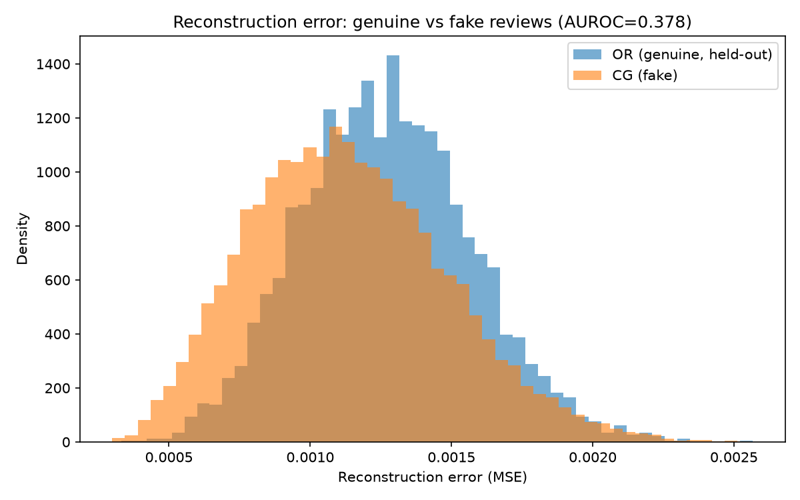
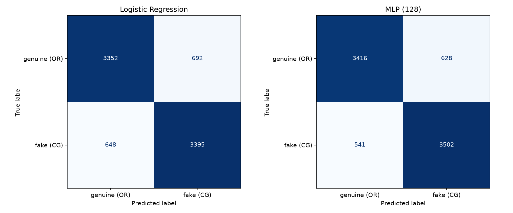

# Evaluating Fake Review Detectors Against Unseen Language Models

**A cross-generator study.** Fake-review detectors are usually tested on fakes from the same AI they were trained on. This project tests whether a detector trained on one generator still catches fakes written by newer models it has never seen.

*MSc Data Analytics, National College of Ireland. Module: Deep Learning & Generative AI (H9DLGA), 2026.*
*Authors: Ibrahim Hameed, Amber Yasin*

---

## Research questions

| | Question | Answer |
|---|---|---|
| **RQ1** | Can a one-class detector trained only on genuine reviews flag machine-generated fakes as anomalies? | **No.** AUROC 0.38–0.42 (below chance) |
| **RQ2** | Does a supervised detector trained on one generator (GPT-2) catch fakes from newer, unseen generators? | **Mostly no.** 86.6% detection on GPT-2 drops to 19.4% on Gemini and 7.2% on Claude |
| **RQ3** | Does adding one modern generator to training improve detection of another unseen one? | **Partly.** Detection roughly doubles but still misses 69–87% |

**Main takeaway:** a high score on a single-generator benchmark overstates how robust a detector is. A model that looks strong on the AI it was trained on can be close to blind to the next one.

## Method

```
Genuine reviews + GPT-2 fakes ─┐
                               ├─► MiniLM sentence embeddings (384-d) ─┬─► One-class detectors (autoencoder, One-Class SVM, k-NN)
Gemini + Claude fakes (ours) ──┘                                        └─► Supervised detectors (Logistic Regression, MLP)
                                                                                        │
                                          Evaluation: in-distribution, unseen generators, leave-one-generator-out
```

- **Embeddings:** [`sentence-transformers/all-MiniLM-L6-v2`](https://huggingface.co/sentence-transformers/all-MiniLM-L6-v2)
- **Split:** stratified 80/20 train/test, random seed 42 throughout
- **Framework:** CRISP-DM

## Data

| File | Rows | Description |
|---|---:|---|
| `data/fake_reviews.csv` | 40,432 | Amazon reviews across 10 categories: 20,216 genuine (`OR`) and 20,216 GPT-2-generated (`CG`). From Salminen et al. (2022). |
| `data/fakes_gemini.csv` | 175 | Fake reviews we generated with Google Gemini (5 categories). Used as an unseen generator. |
| `data/fakes_claude.csv` | 180 | Fake reviews we generated with Anthropic Claude (5 categories). Used as an unseen generator. |

## Results

### RQ1: One-class detection (trained on genuine reviews only)

| Method | AUROC |
|---|---:|
| Autoencoder reconstruction error | 0.378 |
| One-Class SVM (RBF) | 0.423 |
| k-NN cosine distance (k=5) | 0.394 |
| k-NN cosine distance (k=20) | 0.390 |

All scores fall below 0.5: the fake reviews sit *closer* to the genuine training data than held-out genuine reviews do. In embedding space the fakes look like insiders, not outliers.



### Supervised baseline (genuine vs GPT-2)

| Model | Accuracy | Precision | Recall | F1 | AUROC |
|---|---:|---:|---:|---:|---:|
| Logistic Regression | 0.834 | 0.831 | 0.840 | 0.835 | 0.913 |
| MLP (128 hidden units) | **0.855** | **0.848** | **0.866** | **0.857** | **0.934** |



### RQ2 and RQ3: Unseen generators and leave-one-generator-out

| Model trained on | Genuine correctly kept | GPT-2 detected | Gemini detected | Claude detected |
|---|---:|---:|---:|---:|
| Genuine + GPT-2 (baseline) | 84.5% | 86.6% | 19.4% | 7.2% |
| Genuine + GPT-2 + Claude | 85.2% | 85.7% | **30.9%** | (in training) |
| Genuine + GPT-2 + Gemini | 83.8% | 87.5% | (in training) | **12.8%** |

Full write-up of every experiment: [`results/results_summary.md`](results/results_summary.md)

## Repository structure

```
├── data/                 # datasets (see table above)
├── src/
│   ├── one_class_ae_gono_go.py         # RQ1: autoencoder; also builds the embedding cache
│   ├── one_class_score_comparison.py   # RQ1: One-Class SVM and k-NN scores
│   ├── supervised_classifier.py        # Logistic Regression vs MLP baseline
│   ├── unseen_generator_test.py        # RQ2: GPT-2-trained MLP tested on Gemini fakes
│   └── leave_one_generator_out.py      # RQ2/RQ3: Gemini and Claude, both directions
├── results/              # figures, trained models, cached embeddings, results summary
└── requirements.txt
```

## How to run

Requires Python 3.12. Run every script from the repository root, because the file paths are relative to it.

```bash
git clone https://github.com/ihameed11/fake-review-detector-cross-generator.git
cd fake-review-detector-cross-generator
python -m venv .venv && source .venv/bin/activate
pip install -r requirements.txt

python src/one_class_ae_gono_go.py        # run first: creates results/embeddings_cache.npz
python src/one_class_score_comparison.py
python src/supervised_classifier.py
python src/unseen_generator_test.py
python src/leave_one_generator_out.py
```

**Notes**
- `results/embeddings_cache.npz` (about 62 MB) isn't in the repo because of GitHub's file-size limits. The first script regenerates it in a few minutes on CPU.
- Trained models (`*.joblib`) and the Gemini/Claude embeddings are included, so the later scripts reuse them instead of retraining. Delete them to retrain from scratch.
- `requirements.txt` pins `torch==2.2.2` for Intel Macs. On Apple Silicon, Linux or Windows, newer versions should also work.

## Limitations

- The Gemini and Claude samples are small (175 and 180 reviews).
- The modern fakes are shorter than the original dataset (about 15–27 words vs about 67) and use different product categories. Some of the performance drop may come from this distribution shift as well as from the generator itself.
- In RQ3, only about 180 modern fakes were added to roughly 32,000 training examples, without reweighting.

## Reference

Salminen, J., Kandpal, C., Kamel, A.M., Jung, S. and Jansen, B.J. (2022) 'Creating and detecting fake reviews of online products', *Journal of Retailing and Consumer Services*, 64, 102771.
